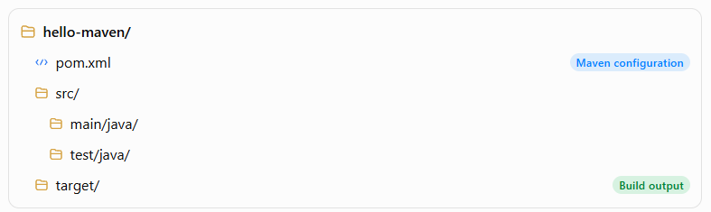

# How to Install Apache Maven on Debian
This guide walks you through installing Apache Maven on Debian 12 or Debian 13. It includes installation, environment verification, and creating a test Maven project.


## 1. Update Debian
Open a terminal and update your package repositories.

```bash
sudo apt update
sudo apt upgrade -y
```


## 2. Install Java JDK
Maven requires Java to run. Install OpenJDK.

```bash
sudo apt install -y default-jdk
```


Verify Java installation:

```bash
java -version
```


Verify the Java compiler:

```bash
javac -version
```


## 3. Install Maven
Install Maven using Debian's package manager.

```bash
sudo apt install -y maven
```


### Find Maven installation directory
Run:
```bash
which mvn
```


For a standard Debian installation using apt, Maven is typically located at:

```
/usr/share/maven
```


Verify:

```
ls -la /usr/share/maven
```


### Set MAVEN_HOME
Open your Bash configuration:

```
nano ~/.bashrc
```

Add the following lines at the bottom:
### Maven configuration


Add these lines at the bottom:
```
# Java JDK
export JAVA_HOME=/usr/lib/jvm/java-21-openjdk-amd64

# Maven
export MAVEN_HOME=/usr/share/maven

# Add Java and Maven to PATH
export PATH=$JAVA_HOME/bin:$MAVEN_HOME/bin:$PATH
```


Save and exit:
- Ctrl + O – Save
- Enter – Confirm
- Ctrl + X – Exit

### Reload environment variables

Run:

```
source ~/.bashrc
```


### Verify Maven configuration
Check MAVEN_HOME:

```
echo $MAVEN_HOME
```

Expected:

```
/usr/share/maven
```

Check Maven:

```
mvn -version
```


Expected output should look similar to:

```
Apache Maven 3.x.x
Maven home: /usr/share/maven
Java version: 21
Java home: /usr/lib/jvm/java-21-openjdk-amd64
```


This installs Maven and its required dependencies.
## 4. Verify Maven Installation
Check the installed Maven version.

```bash
mvn -version
```


You should see output similar to:

```
Apache Maven 3.x.x
Maven home: /usr/share/maven
Java version: 21.x.x
Java home: /usr/lib/jvm/...
Default locale: en_US
OS name: "linux"
```


Your version numbers may differ.
## 5. Check Maven Installation Location
Find the Maven executable:

```bash
which mvn
```


Expected output:

```
/usr/bin/mvn
```


Check the Maven installation directory:

```bash
ls -la /usr/share/maven
```

If Maven is installed correctly through Debian's apt package manager, you should see something similar to:

```
total 24
drwxr-xr-x  5 root root 4096 ...
drwxr-xr-x  ...
drwxr-xr-x  2 root root 4096 ... bin
drwxr-xr-x  2 root root 4096 ... boot
drwxr-xr-x  2 root root 4096 ... conf
drwxr-xr-x  2 root root 4096 ... lib
```

Important directories:

| Directory	| Purpose |
|-------------------|-------------------|
| bin	| Maven executables and scripts |
| boot	 | Maven startup components |
| conf	| Maven configuration files |
| lib |	Maven libraries |

### Verify Maven executable
Run:

```bash
ls -la /usr/share/maven/bin/
```


You should see:
```
mvn
mvnDebug
```


## 6. Configure Maven Environment Variables (Optional)
Debian normally configures Maven automatically. You can inspect the Java and Maven environment variables.

```bash
echo $JAVA_HOME
echo $MAVEN_HOME
```


Find your Java installation directory:

```bash
readlink -f $(which java)
```


For example, if Java is installed under /usr/lib/jvm/java-21-openjdk-amd64, you can configure JAVA_HOME.

Edit your Bash configuration:

```bash
nano ~/.bashrc
```

Add:

```bash
export JAVA_HOME=/usr/lib/jvm/java-21-openjdk-amd64
export PATH=$JAVA_HOME/bin:$PATH
```

Save and reload:

```bash
source ~/.bashrc
```

Verify:

```bash
echo $JAVA_HOME
```

## 7. Create a Test Maven Project
Let's create a simple Java project using Maven.

Create a project directory:

```bash
mkdir -p ~/MavenProjects
cd ~/MavenProjects
```

Generate a Maven project:

```bash
mvn archetype:generate \
  -DgroupId=com.example \
  -DartifactId=hello-maven \
  -DarchetypeArtifactId=maven-archetype-quickstart \
  -DinteractiveMode=false
```

Enter the project:

```bash
cd hello-maven
```

## 8. Build the Maven Project
Compile and package your Java application.

```bash
mvn clean package
```

You should see:

```
BUILD SUCCESS
```


The compiled application will be available under:

```
target/
```


Run the generated Java application:

```bash
java -cp target/hello-maven-1.0-SNAPSHOT.jar com.example.App
```

Expected output:

```
Hello World!
```


## 9. Useful Maven Commands


| Command	| Description |
|--------------------|---------------------|
| mvn -version	| Display Maven version |
| mvn clean	| Remove previous build files |
| mvn compile	| Compile Java source code |
| mvn test	| Run unit tests |
| mvn package	| Create JAR or WAR |
| mvn install	| Install artifact in local repository |
| mvn clean install	| Clean, build, test, and install |
| mvn dependency:tree	| Display project dependencies |

## 10. Maven Directory Structure





## 11. Uninstall Maven (If Needed)
To remove Maven:

```bash
sudo apt remove maven
```

To remove Maven and unused dependencies:

```bash
sudo apt autoremove -y
```


Final Verification Checklist
Run these commands to verify your Debian development environment.

```bash
java -version
javac -version
mvn -version
which mvn
```


Installation complete
You now have Java JDK and Apache Maven installed on Debian.

## Official documentation:

- [Apache Maven Installation Guide](https://maven.apache.org/install.html)
- [Apache Maven User Guide](https://maven.apache.org/guides/)
- [Debian Maven Package](https://packages.debian.org/maven)


# [README](./../../README.md)
