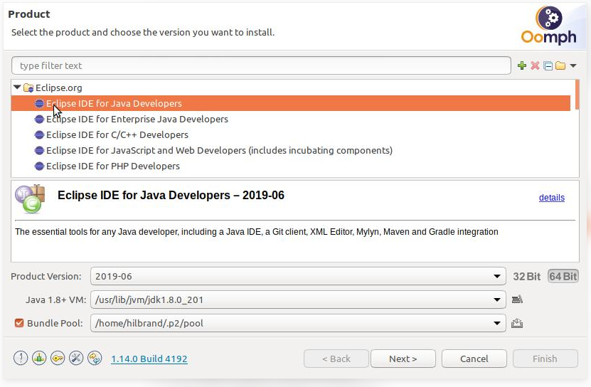
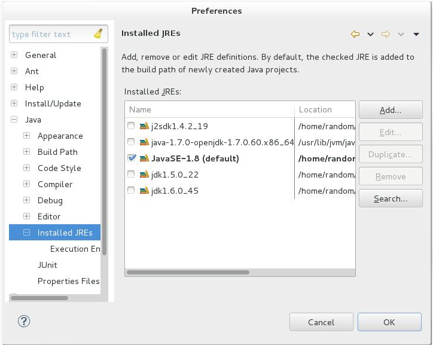
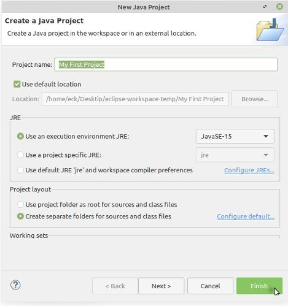

# How to Install Eclipse IDE on Debian
These instructions will install **Eclipse IDE for Java Developers** on your Debian Linux desktop.

Since you installed OpenJDK 21, you can use that JDK with Eclipse.

I recommend using the official Eclipse Installer rather than the Debian repository version because it lets you install and manage current Eclipse releases. 
Eclipse Packages+1

# Step 1. Verify Java is installed
Open a terminal:

```bash
java -version
javac -version
```

If Java is not installed:

```bash
sudo apt update
sudo apt install -y openjdk-21-jdk
```


# Step 2. Install required packages

```bash
sudo apt update

sudo apt install -y \
    wget \
    tar \
    gzip \
    libgtk-3-0 \
    libx11-xcb1
```

# Step 3. Download Eclipse Installer
Open the official Eclipse download page:

[Download Eclipse IDE](https://www.eclipse.org/downloads/?utm_source=chatgpt.com)

Select Download x86_64 for a standard 64-bit Intel/AMD Debian computer.

Alternatively, download the Linux installer from the Eclipse website.

# Step 4. Extract the installer

Open your Downloads directory:

```bash
cd ~/Downloads
```

Find the downloaded archive:

```bash
ls -lh eclipse-inst*
```

Extract it (adjust filename if needed):

```bash
tar -xzf eclipse-inst-jre-linux64.tar.gz
```

Enter the extracted directory:

```bash
cd eclipse-installer
```

Start the installer:

```bash
./eclipse-inst
```

If permission is denied:

```bash
chmod +x eclipse-inst
./eclipse-inst
```

# Step 5. Install Eclipse IDE





When the installer opens:
1. Select Eclipse IDE for Java Developers.
2. Choose the installation folder. For example:

```bash
/home/john/eclipse/java-2026
```

3. Select the Java 21 JDK if prompted.
4. Click Install.
5. Accept the license agreements.
6. Wait for installation to finish.
7. Click Launch.

# Step 6. Launch Eclipse
After installation, Eclipse can be started from your desktop application menu.

You can also locate the executable:

```bash
find ~/eclipse -name eclipse -type f
```

Run it using its full path, for example:

```bash
~/eclipse/java-2026/eclipse/eclipse
```

# Step 7. Configure Java 21 inside Eclipse




Inside Eclipse:
1. Select Window → Preferences.
2. Expand Java.
3. Select Installed JREs.
4. Click Add.
5. Select Standard VM.
6. Set the JRE home directory to:

```
/usr/lib/jvm/java-21-openjdk-amd64
```

7. Click Finish.
8. Select Java 21 as the default JDK.
9. Click Apply and Close.


# Step 8. Create your first Java project



1. Select File → New → Java Project.
2. Project name: HelloWorld.
3. Select Java 21.
4. Click Finish.
5. Right-click src.
6. Select New → Class.
7. Class name: HelloWorld.
8. Add this code:


```java

public class HelloWorld {

    public static void main(String[] args) {

        System.out.println("Hello from Eclipse on Debian!");

    }
}
```


Click the green Run button.

Expected output:

```
Hello from Eclipse on Debian!
```


Your Java development environment

Java Development Setup

| Software	| Version |
|-------------|----------------|
| Operating system |	Debian 13 |
| JDK	  | OpenJDK 21 |
| IDE	| Eclipse  |
| Compiler   | javac |
| Build tool | Maven (optional) |
| Testing  | JUnit (optional) |


Official resource: [Eclipse IDE packages](https://www.eclipse.org/downloads/packages/?utm_source=chatgpt.com)


# [README](./../../README.md)
