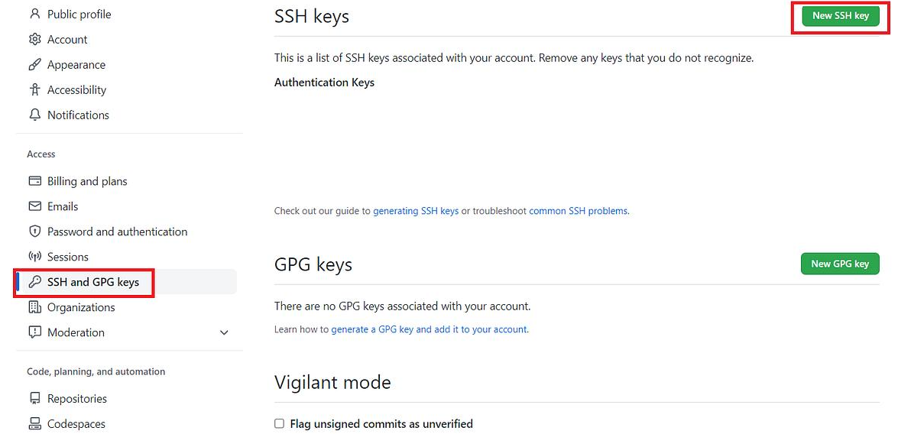
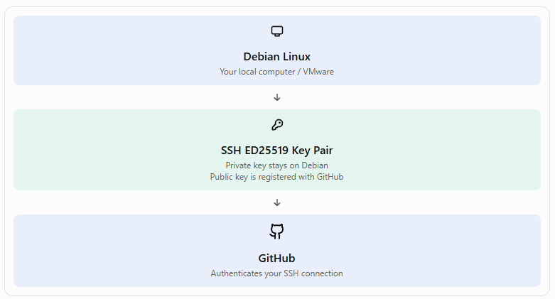

# Set Up SSH for GitHub on Debia

**Set Up SSH for GitHub on Debian**

This guide walks you through configuring SSH authentication on your Debian Linux system so you can connect to GitHub without entering your GitHub username and password every time you use Git.

We'll use an **ED25519 SSH key**, which is recommended by GitHub.

**Step 1. Install SSH**

Open your Debian terminal.

```bash
sudo apt update

sudo apt install -y openssh-client git

```

Verify SSH is installed:

```bash
ssh -V
```

Verify Git:

```bash
git --version
```

**Step 2. Check for existing SSH keys**

Before creating a new key, check whether you already have one.

```bash
ls -la ~/.ssh
```

Look for these files:

| **File**       | **Purpose**     |
|----------------|-----------------|
| id_ed25519     | Private SSH key |
| id_ed25519.pub | Public SSH key  |

**Important:** Never share your private key (id_ed25519). Only the .pub file should be uploaded to GitHub.

**Step 3. Generate an SSH key**

Run this command, replacing the email with your GitHub email address.

```bash
ssh-keygen -t ed25519 -C "your_email@example.com"
```

When prompted:

```
Enter file in which to save the key:
```

Press Enter to accept the default:

```bash
/home/john/.ssh/id_ed25519
```

Enter a passphrase when prompted. You can also leave it empty, although a passphrase is recommended.

**Step 4. Start the SSH agent**

Start the SSH agent:

```bash
eval "$(ssh-agent -s)"
```

Add your private key:

```bash
ssh-add ~/.ssh/id_ed25519
```

Verify the key is loaded:

```bash
ssh-add -l
```

You should see your ED25519 key listed.

**Step 5. Copy your public SSH key**

Display your public key:

```bash
cat ~/.ssh/id_ed25519.pub
```

Copy the entire output.

It should look similar to:

```
ssh-ed25519 AAAAC3NzaC1lZDI1NTE5AAAA... your_email@example.com
```

You can also copy it directly to your clipboard if xclip is installed:

```bash
sudo apt install -y xclip

xclip -selection clipboard < ~/.ssh/id_ed25519.pub
```

**Step 6. Add SSH key to GitHub**

1.  Open GitHub: [GitHub SSH Keys](https://github.com/settings/keys?utm_source=chatgpt.com).

2.  Sign in to your GitHub account.

3.  Click **New SSH key**.




4. Enter the following:

| **Field** | **Value**                 |
|-----------|---------------------------|
| Title     | Debian VMware             |
| Key type  | Authentication Key        |
| Key       | Paste your public SSH key |

5. Click **Add SSH key**.

**Step 7. Test your GitHub connection**

Back in your Debian terminal, execute:

```bash
ssh -T git@github.com
```

The first time, you may see:

```
The authenticity of host 'github.com' can't be established.

Are you sure you want to continue connecting (yes/no/[fingerprint])?
```

Type:

```
yes
```

A successful connection should display something similar to:

```
Hi YOUR_USERNAME! You've successfully authenticated,

but GitHub does not provide shell access.
```

SSH connection successful

**Step 8. Configure Git**

Set your Git identity:

```bash
git config --global user.name "Your Name"

git config --global user.email "your_email@example.com"
```

Verify:

```bash
git config --global --list
```

**Step 9. Clone a GitHub repository using SSH**

Instead of HTTPS, use the SSH repository address.

Example:

```bash
git clone git@github.com:USERNAME/REPOSITORY.git
```

For example:

```bash
git clone git@github.com:progressivepull/my-project.git
```

**Step 10. Configure SSH to use your GitHub key**

Create an SSH configuration file:

```bash
nano ~/.ssh/config
```

Add:
```
Host github.com
   HostName github.com
   User git
   IdentityFile ~/.ssh/id_ed25519
   IdentitiesOnly yes
   AddKeysToAgent yes
```

Save and exit.

Set appropriate permissions:

```bash
chmod 700 ~/.ssh
chmod 600 ~/.ssh/config
chmod 600 ~/.ssh/id_ed25519
chmod 644 ~/.ssh/id_ed25519.pub
```

**Final verification checklist**

Run these commands:

```bash
# Check SSH version
ssh -V

# Check SSH keys
ls -la ~/.ssh

# Check SSH agent
ssh-add -l

# Test GitHub connection
ssh -T git@github.com

# Check Git configuration
git config --global --list
```

**SSH authentication workflow**



**Official documentation:** [GitHub – Connecting to GitHub with SSH](https://docs.github.com/en/authentication/connecting-to-github-with-ssh?utm_source=chatgpt.com).

**Next step:** I can help you configure GitHub on Debian, including SSH authentication, cloning repositories, committing changes, and pushing code to GitHub.

# [README](./../../../README.md)
